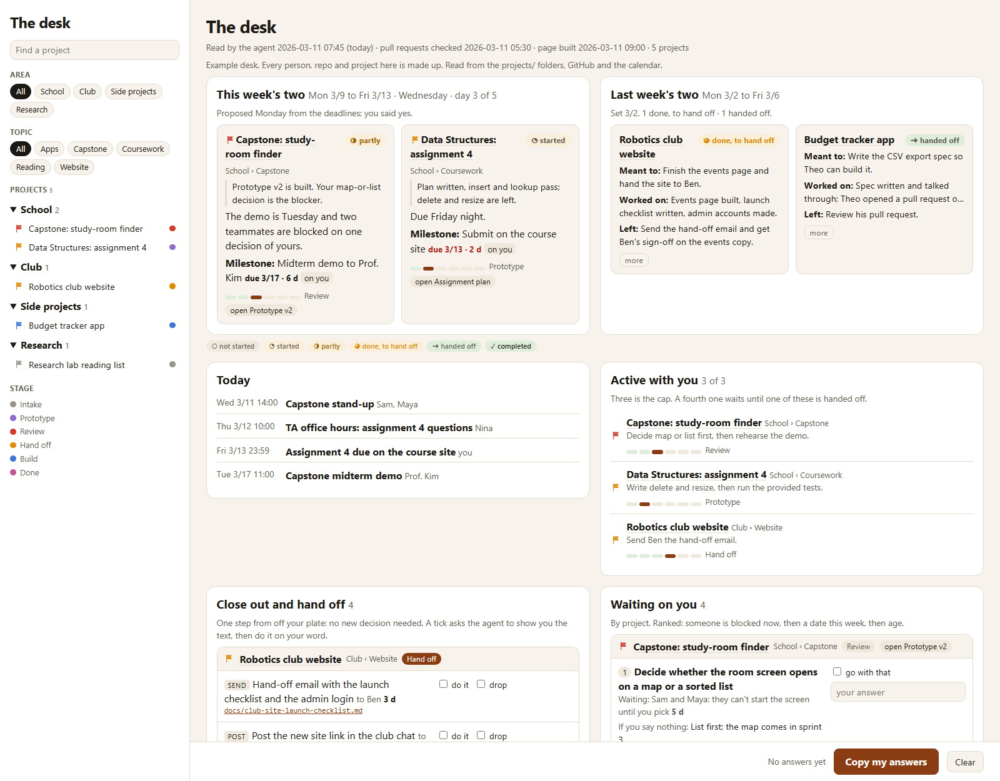

# The desk: an agent skill for your project board

You have more projects than you can hold in your head: a capstone, assignments, a club, a side app. Each one waits on a teammate or a date, or, most often, on a decision of yours.

**The desk** is a skill you give your coding agent (Claude Code, Codex, Cursor or similar). When you type `/desk`, the agent reads your projects (local folders, GitHub, your tracker, your calendar) and writes one local web page. The page tells you what waits on you and lets you answer from the page.



## What the page does

- **Opens decision docs and artifacts in one click:** markdown files that need your decisions, prototypes, pull requests.
- **"Resume in a new chat"** for every project. It copies a ready first message that puts a fresh chat in position on its first turn.
- **A page per project** with:
  - the stage track and the status;
  - scope, goal, the current milestone and who it is on, and the project's age;
  - the related parts and links.
- **This week's two priorities and last week's two**, on one status scale (○ not started … ✓ completed).
- **Active with you:** the projects you are working on now, at most three.
- **Waiting on you:** a ranked list, with a default on each row ("if you say nothing: …").
- **Close out and hand off:** the things one step from done (a send, a post, a sign-off).
- **Check this:** two records that disagree, like two different due dates.
- **Nothing moving:** stalled projects you can park, keeping the way back in.
- **An answers block.** Tick boxes and type answers on the page, press **Copy my answers**, and paste the block back to the agent. It acts on each line.

The page is one HTML file with no server and no dependencies. It works on a wide monitor and on a phone.

## Two rules the skill keeps

1. **It only reads your sources.** It never comments, changes a status, commits or pushes on its own.
2. **Anything that reaches a person waits for you to say "send it".** It shows you the full text and who gets it first. A tick on the page is your decision, not permission to send.

Every decision is written so you can read it cold, a week later: what it is, where it sits, why it matters now, and the default.

## Quick start (5 minutes)

You need [Node.js](https://nodejs.org) 16 or newer. The [GitHub CLI](https://cli.github.com) (`gh`) is optional.

**1. See the example.** It is made up: one student, five projects.

```bash
node desk/render.js --data example
```

Then open `example/index.html` in a browser. Click a project in the left rail, try **Resume in a new chat**, tick a few boxes and press **Copy my answers**.

**2. Install the skill in your project.**

| Harness | Where `skill/` goes |
|---|---|
| Claude Code | `.claude/skills/desk/`, in your project or in `~/.claude/skills/desk/` for all projects. Type `/desk`. |
| Codex, Cursor, others that read `SKILL.md` folders | That harness's skills folder (many read `.agents/skills/desk/`). Check your harness's docs for the exact path. |
| A harness without skills | Put the folder anywhere, and add one line to `AGENTS.md` (Codex) or a rule in `.cursor/rules/` (Cursor): *When I say "desk", follow `skill/SKILL.md`.* |

`disable-model-invocation: true` in `SKILL.md` is a Claude Code setting: it means the skill runs only when you call it. Other harnesses ignore it. If your harness takes `/desk` as an unknown command, type "run the desk" instead.

**3. Copy the scripts.** Copy the `desk/` folder (with `render.js`, `refresh.js` and `scan.js`) to your project root. Your data will live next to the scripts, in `desk/`.

**4. Run it.** Type `/desk`. The first run is setup (below): the agent looks around, sends you one message of guesses, writes `desk/desk.config.json` from your reply and does the first read. It ends by opening `desk/index.html`.

**5. Keep your data out of git.** The data names people and what they wait for. Add these lines to your `.gitignore`:

```
desk/desk.json
desk/projects/
desk/answers/
desk/backlog.json
desk/index.html
desk/*.log
desk/scan.json
desk/scan.md
desk/SETUP-NOTES.md
```

## First run: setup

The first `/desk` (or `/desk setup` any time later) learns your setup instead of asking you to fill in a form.

1. **It scans.** `node desk/scan.js` lists what your harness has: the agent (Claude Code, Codex, Cursor and others), its skills, agents, hooks and MCP servers; your session pieces, like an end-of-session hook, a sessions table or resume prompts; your project folders, status files, boards, goals and decision sheets; your git repos. It records names, counts and paths only. It never records tokens, environment values or full commands, and it opens no network connection.
2. **It reads a few files** (the top block only) and checks which sources it can actually reach right now.
3. **It writes `desk/SETUP-NOTES.md`:** what it found, what it thinks you are (a student, a lead, a solo developer…), how the desk will read your work, and a few suggestions it will not act on without your yes.
4. **It sends one message** of at most ten numbered guesses, each with a default. You fix any by number in one reply, or say "go". There is no second round.
5. **It writes a light config** and does the first read.

Setup only reads. It writes nothing outside `desk/`, and the scan and the notes stay on your machine (they are in the `.gitignore` lines above). To see what it produces, look at `example/harness/` (a made-up project) and `example/harness-scan/` (its scan, notes, steering message and the config that came out).

## Every day

| You want | Do |
|---|---|
| A fresh read | `/desk` |
| To pick a project back up | `/desk resume capstone`, or press **Resume in a new chat** on its page |
| To answer what waits on you | Tick and type on the page, press **Copy my answers**, paste the block into the chat |
| Just new ages and pull request states, with no agent | `node desk/refresh.js` (add `--offline` without GitHub) |

## Make it run every morning

The idea: before you sit down, the page has been refreshed and is open on your screen. Each script below runs the agent headless, which means no chat and nobody watching. The agent may read, and may write only inside `desk/`. If the agent run fails, the script falls back to `refresh.js`, so the page always opens with current ages.

| Where | How |
|---|---|
| **Claude Code, on your machine** | Use one of the three scheduler rows below. They all run `claude -p` with a short allow list (read tools, `desk/` writes, `node desk/*.js`, `gh pr`). Add your tracker's and calendar's read-only MCP tools to the list in the script. |
| **Claude Code, in the cloud** | `/schedule` creates a routine that runs on a schedule, using `schedule/morning-prompt.md` as its prompt. It runs on a copy of your repo in the cloud, though. It can't open a page on your screen, and your desk data would have to live in a (private) repo. For most people the local run is simpler. |
| **Windows** (Task Scheduler) | `schedule/desk-morning.ps1`. Try it by hand with `-ProjectDir "C:\path\to\your-project"`. The registration commands are at the top of the file. |
| **macOS** (launchd) | `schedule/local.desk.morning.plist` runs `schedule/desk-morning.sh`. The steps are in the file. |
| **Linux** (cron) | `schedule/crontab.txt` has the line to add with `crontab -e`. |
| **Another agent** | Swap the `claude -p ...` call in the script for your harness's headless mode (Codex: `codex exec`), with its own read-only settings. |

## Adapt it

Everything is in `desk/desk.config.json`. Start from `skill/desk.config.example.json`.

- **Stages.** Any ladder of any length; the page draws whatever you list.
  - A project ladder: `Intake → Prototype → Review → Hand off → Build → Done`
  - A course ladder: `Reading → Assignment → Draft → Feedback → Submitted`

  Set `closeout_stage` to the stage that means "one step from done".
- **Areas.** Your top-level groups, like School, Club, Side projects or Work. Each project also has an optional `subarea` (a topic). The left rail filters by both.
- **Sources.** Where the agent reads. Any mix of these:
  - `local`: project folders with a `STATUS.md`, decision docs, git history;
  - `github`: pull requests and issues, read with `gh`;
  - `tracker`: Linear, Jira, Trello, Notion, ClickUp or anything else you reach through an MCP server;
  - `calendar`: the next five days, through a calendar MCP server.

  Just markdown folders is fine.
- **Labels.** The section titles, the word for a task ("Card", "Issue"), the date style (`m/d`, `d/m`, `iso`), and the active cap (`max_active`).

The data shapes (a project record, the board's rows, the answers block) are in `skill/CONTRACT.md`. If you change what the agent writes, change it there first.

## What's in the folder

```
skill/      SKILL.md (the modes), SETUP.md (the first run), CONTRACT.md (the data), desk.config.example.json
desk/       render.js (draws the page), refresh.js (no-model morning refresh), scan.js (the read-only setup scan)
example/    a made-up student's desk; render it with --data example
  harness/        a made-up project for the setup scan
  harness-scan/   what setup produced for it: scan.json, scan.md, SETUP-NOTES.md, the steering message, the config
schedule/   Windows, macOS, Linux and Claude Code morning-run examples
```

## License

MIT. See `LICENSE`.
